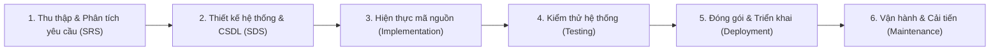
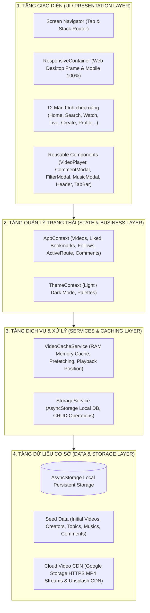
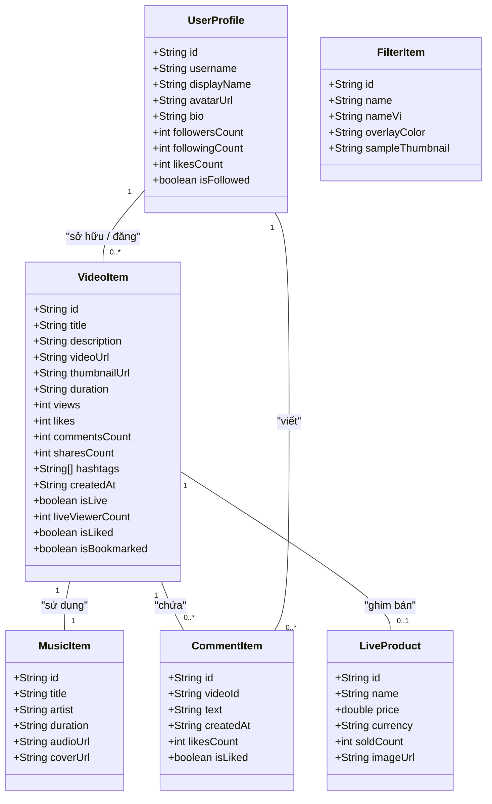
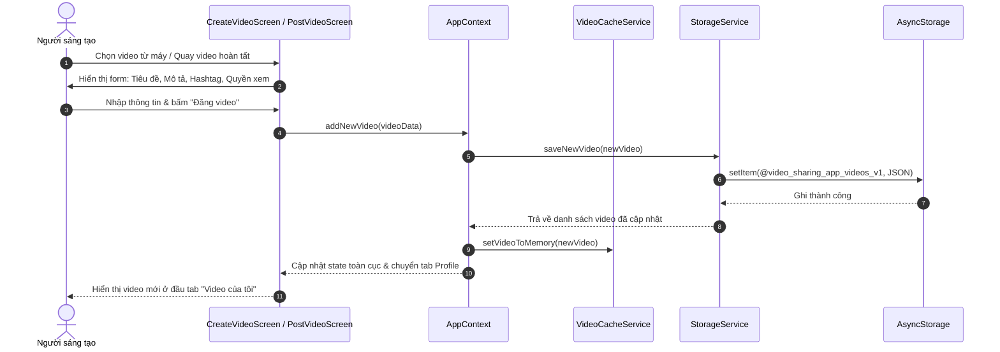
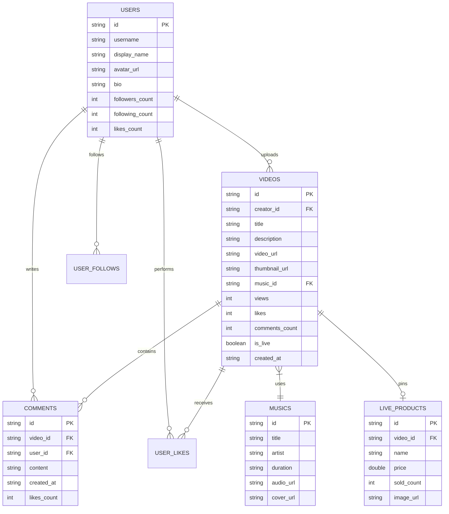

# BÁO CÁO ĐỀ TÀI PHÁT TRIỂN ỨNG DỤNG DI ĐỘNG
# ĐỀ TÀI: XÂY DỰNG NỀN TẢNG CHIA SẺ VIDEO ĐA NỀN TẢNG (VIDEO SHARING APP)

---

## THÔNG TIN CHUNG
- **Tên đề tài:** Ứng dụng Chia sẻ Video ngắn Đa nền tảng (Video Sharing Application)
- **Nền tảng công nghệ:** React Native (Expo SDK 58), TypeScript, React Native Web, Expo AV, AsyncStorage
- **Ngôn ngữ giao diện:** Tiếng Việt (100% bản địa hóa)
- **Khả năng tương thích:** Android, iOS, Tablet và Trình duyệt Web (Desktop/Laptop)
- **Mô hình phát triển:** SDLC (Software Development Life Cycle) kết hợp Agile/Scrum

---

## DANH SÁCH THÀNH VIÊN & PHÂN CHIA VAI TRÒ (SDLC)

| STT | Họ và Tên | Vai trò SDLC | Nhiệm vụ chính trong dự án |
| :---: | :--- | :--- | :--- |
| 1 | **Nguyễn Văn A** (Nhóm trưởng) | Project Manager / System Architect | Lập kế hoạch SDLC, thiết kế kiến trúc tổng thể, quản lý tiến độ, tích hợp core State & Responsive Container. |
| 2 | **Trần Thị B** | UI/UX Designer & Frontend Dev | Thiết kế và hiện thực UI 12 màn hình theo Figma, xây dựng Design System, tối ưu CSS/Flexbox responsive. |
| 3 | **Lê Hoàng C** | Fullstack / Storage Engineer | Thiết kế CSDL (ERD), hiện thực StorageService (AsyncStorage), đồng bộ dữ liệu local, quản lý state bài đăng/nháp. |
| 4 | **Phạm Quốc D** | Performance & Media Specialist | Hiện thực VideoPlayer đa nền tảng (Web HTML5 + Mobile Expo AV), thuật toán Cache RAM & Video Prefetching. |
| 5 | **Hoàng Minh E** | QA / QC Engineer & Tech Writer | Thiết kế bộ Test Cases, thực hiện kiểm thử chức năng & tích hợp, soạn thảo tài liệu SRS, SDS, Slide và Kịch bản Demo. |

---

# I. TỔNG QUAN DỰ ÁN & YÊU CẦU SẢN PHẨM (DELIVERABLES)

### 1.1. Đặt vấn đề & Mục tiêu đề tài
Trong kỷ nguyên số, các nền tảng video ngắn (như TikTok, YouTube Shorts, Instagram Reels) đã trở thành xu hướng tiếp cận thông tin và giải trí hàng đầu. Mục tiêu của dự án là xây dựng một **Video Sharing App** hoàn chỉnh, hiện đại, hỗ trợ đầy đủ các thao tác của người sáng tạo nội dung và người xem, tương thích hoàn toàn trên cả thiết bị di động (Android, iOS) và máy tính (Web Desktop) với giao diện tiếng Việt thân thiện.

### 1.2. Các sản phẩm bàn giao (Deliverables)
1. **Source Code hoàn chỉnh:** Mã nguồn sạch, module hóa, 100% TypeScript, tuân thủ tiêu chuẩn coding chuẩn quốc tế.
2. **Sản phẩm chạy được (Executable Prototype):** Chạy mượt mà trên Expo Web (`npm run web`) và Mobile qua Expo Go.
3. **Bộ tài liệu SDLC phân giai đoạn:** SRS (Yêu cầu), SDS (Thiết kế kiến trúc/UML), Báo cáo kiểm thử (Test Matrix), Hướng dẫn triển khai.
4. **Slide báo cáo thuyết trình (5-7 Slide):** Tóm tắt dự án để thuyết trình trong 5 phút kèm bản trình chiếu web tương tác.
5. **Kịch bản Video Demo (1-3 phút):** Kịch bản chi tiết từng phân cảnh và lời bình tiếng Việt.
6. **File hướng dẫn chạy source:** Hướng dẫn chi tiết từng bước cài đặt và kiểm thử.

---

# II. QUY TRÌNH PHÁT TRIỂN PHẦN MỀM (SDLC PHÂN GIAI ĐOẠN)



---

## GIAI ĐOẠN 1: REQUIREMENT ANALYSIS (PHÂN TÍCH YÊU CẦU - SRS)

### 1. Khảo sát đối tượng người dùng (Target Personas)
- **Người xem thông thường (Viewer):** Cần trải nghiệm xem video mượt mà, thao tác vuốt chuyển nhanh, tìm kiếm video theo chủ đề (thú cưng, nấu ăn, du lịch...), tương tác thả tim, bình luận, chia sẻ.
- **Người sáng tạo nội dung (Creator):** Cần công cụ quay/tải video dễ dàng, áp dụng bộ lọc màu thời thượng, chọn âm thanh nền phong phú, gắn thẻ hashtag, xem thông số lượt xem và lượng người theo dõi trên trang cá nhân.
- **Chủ cửa hàng Livestream (Live Streamer / Shop):** Cần phát trực tiếp bán hàng, ghim sản phẩm kèm giá mua ngay, nhận phản hồi trực tiếp từ người xem.

### 2. Xác định các Tác nhân (Actors)
1. **Khách vãng lai (Guest):** Xem video xu hướng, tìm kiếm nội dung, nghe âm thanh.
2. **Người dùng đã đăng nhập (Registered User):** Tương tác like, bình luận, bookmark, theo dõi tài khoản khác, chỉnh sửa hồ sơ.
3. **Người sáng tạo (Creator):** Quay video, thêm hiệu ứng/nhạc, đăng video, quản lý video cá nhân.
4. **Người phát trực tiếp (Live Streamer):** Tổ chức phiên phát sóng trực tiếp, ghim sản phẩm tương tác.

### 3. Danh sách 12 chức năng chính (Bám sát thiết kế Figma)
1. **Trang chủ & Khám phá (Home - Video Listing):** Story bar, Top xu hướng, 8 chủ đề (Thể thao, Tin tức, Du lịch...), Live stream nổi bật, Âm thanh hot.
2. **Tìm kiếm & Phân loại (Search & Discover):** Thanh tìm kiếm gợi ý, Tab phân loại (Xu hướng, Tài khoản, Live, Âm thanh), Lưới video 2 cột, Tag quan tâm.
3. **Xem video toàn màn hình (Video Watching / Shorts Player):** Trình phát video chuẩn 9:16, Sidebar tương tác (Tim, Comment, Lưu, Chia sẻ, Theo dõi nhanh), Âm thanh nền quay tròn.
4. **Bình luận video (Comment on Video):** Modal vuốt trượt từ dưới lên, hiển thị danh sách bình luận kèm avatar, thời gian, số like và form gửi bình luận mới.
5. **Phát trực tiếp bán hàng (Video Streaming / Live):** Trình phát Live, huy hiệu số người xem trực tiếp, bong bóng cảm xúc (tim, cười, like) bay bổng thời gian thực, thẻ sản phẩm ghim mua ngay, chat trực tiếp.
6. **Xưởng tạo video & Kính ngắm (Create Video - Studio):** Viewfinder camera, thanh công cụ bên phải (Lật camera, Bộ lọc, Hẹn giờ 3s/10s, Đèn flash), nút quay video đếm ngược, nút tải file từ thiết bị.
7. **Chọn bộ lọc hiệu ứng (Select Filter):** 9 bộ lọc chuyên nghiệp (None, Film, Trắng đen, Tự nhiên, Nghệ thuật, Cổ điển, Mùa xuân, Em bé, Tương phản) áp dụng trực tiếp lên video.
8. **Chọn âm thanh nền (Select Music):** Danh sách bản nhạc mẫu, nghe thử audio preview, thời lượng, nút "Sử dụng" để lồng vào video.
9. **Đăng video lên mạng xã hội (Post Video):** Xem trước và đổi ảnh bìa, nhập tiêu đề, mô tả, gắn hashtag, gắn thẻ bạn bè, bật/tắt bình luận, quyền riêng tư, tùy chọn đồng bộ Facebook/Twitter/Instagram, Lưu nháp và Đăng video.
10. **Hồ sơ cá nhân của tôi (My Profile):** Avatar, Tên, Tiểu sử, Thống kê (Đang follow, Người theo dõi, Lượt thích), Tab nội dung (Video của tôi, Hình ảnh, Đã thích, Đã lưu), Modal chỉnh sửa thông tin.
11. **Chi tiết hồ sơ tác giả (Creator Profile):** Xem trang cá nhân người khác, nút Theo dõi/Hủy theo dõi, Nhắn tin, Tài khoản gợi ý liên quan.
12. **Danh sách Bạn bè & Đang theo dõi (Follow/Following):** Danh sách người đang theo dõi, người theo dõi mình, tìm kiếm nhanh và gợi ý kết bạn mới.

### 4. Yêu cầu phi chức năng (Non-Functional Requirements)
- **Tương thích đa nền tảng:** Chạy 100% trên Web (HTML5 Video + Responsive) và Mobile (Expo-AV native).
- **Hiệu năng cao:** Thời gian phản hồi giao diện < 100ms, video phát mượt mà không giật lag.
- **Bộ nhớ đệm (Cache):** Lưu trữ dữ liệu trên máy bằng AsyncStorage và bộ nhớ RAM để xem video mượt mà khi ngoại tuyến (Offline-First).
- **Tính thẩm mỹ:** Dark Mode và Light Mode, chuẩn thiết kế hiện đại tông hồng năng động (`#FF2A6D`).

---

## GIAI ĐOẠN 2: SYSTEM DESIGN (THIẾT KẾ HỆ THỐNG - SDS)

### 2.1. Kiến trúc tổng thể hệ thống (Architecture Overview)

Dự án áp dụng kiến trúc **Modular Multi-Tier Client Architecture** kết hợp mô hình **Offline-First Storage**:



---

### 2.2. Sơ đồ UML Use Case (Use Case Diagram)

```mermaid
flowchart LR
    User(("Người dùng (User)"))
    Creator(("Người sáng tạo (Creator)"))
    Streamer(("Người phát Live (Streamer)"))

    User --> UC1["Xem danh sách & Tìm kiếm Video"]
    User --> UC2["Xem Video toàn màn hình & Vuốt lướt"]
    User --> UC3["Thả tim (Like) & Lưu (Bookmark)"]
    User --> UC4["Bình luận & Đọc bình luận"]
    User --> UC5["Theo dõi / Hủy theo dõi tài khoản"]
    User --> UC6["Xem Live Stream & Thả cảm xúc trực tiếp"]
    User --> UC7["Xem & Chỉnh sửa hồ sơ cá nhân"]

    Creator --> UC8["Quay / Tải video từ máy"]
    Creator --> UC9["Áp dụng Bộ lọc (Filter) & Âm thanh (Audio)"]
    Creator --> UC10["Đăng video & Gắn hashtag & Lưu nháp"]

    Streamer --> UC11["Phát trực tiếp & Ghim sản phẩm"]

    User <|-- Creator
    Creator <|-- Streamer
```

---

### 2.3. Sơ đồ UML Class (Class Diagram)



---

### 2.4. Sơ đồ Tuần tự UML (Sequence Diagram: Đăng Video Mới)



---

### 2.5. Sơ đồ Thực thể Quan hệ CSDL (ERD - Entity Relationship Diagram)



---

## GIAI ĐOẠN 3: IMPLEMENTATION (HIỆN THỰC MÃ NGUỒN & MODULE HÓA)

### 3.1. Cấu trúc tổ chức thư mục dự án
```
d:\nam 4\Mobile\Prj/
├── App.tsx                     # Điểm khởi chạy chính & bộ điều hướng màn hình
├── app.json                    # Cấu hình Expo, icon, splash, permissions, web
├── package.json                # Quản lý dependencies (Expo SDK 58, React Native 0.88)
├── tsconfig.json               # Cấu hình TypeScript nghiêm ngặt (Strict mode)
├── docs/                       # Tài liệu đồ án, slide và ảnh giao diện mẫu
│   └── screens/                # 12 ảnh mockup thiết kế màn hình
├── src/
│   ├── types/                  # Định nghĩa Typescript Interfaces
│   │   └── index.ts
│   ├── data/                   # Dữ liệu hạt giống (Seed Data)
│   │   ├── initialCreators.ts  # Danh sách tài khoản người dùng & tác giả mẫu
│   │   ├── initialVideos.ts    # Danh sách video đa dạng chủ đề với link HTTPS
│   │   ├── initialTopics.ts    # 8 chủ đề khám phá (Thể thao, Du lịch, Nấu ăn...)
│   │   ├── initialMusics.ts    # Danh sách bài hát thịnh hành kèm audio preview
│   │   ├── initialFilters.ts   # 9 bộ lọc màu hình ảnh chuyên nghiệp
│   │   └── initialComments.ts  # Bình luận mẫu tiếng Việt
│   ├── services/               # Tầng dịch vụ & Xử lý nghiệp vụ
│   │   ├── storageService.ts   # Lưu trữ AsyncStorage (Likes, Follows, Drafts, Posts)
│   │   └── videoCacheService.ts# Bộ nhớ đệm RAM, Prefetching & Playback Resume
│   ├── context/                # Quản lý trạng thái toàn cục
│   │   ├── AppContext.tsx      # Quản lý tương tác video, định tuyến, người dùng
│   │   └── ThemeContext.tsx    # Chế độ Sáng / Tối (Light & Dark theme)
│   ├── components/             # Các Component tái sử dụng
│   │   ├── ResponsiveContainer.tsx # Tương thích Web Desktop Frame & Mobile 100%
│   │   ├── VideoPlayer.tsx     # Trình phát video Đa nền tảng (HTML5 & Expo-AV)
│   │   ├── HeaderBar.tsx       # Thanh điều hướng trên cùng kèm logo & chuông
│   │   ├── BottomTabBar.tsx    # Thanh tab dưới cùng 5 tab kèm nút tạo video (+)
│   │   ├── CommentModal.tsx    # Modal bình luận vuốt trượt
│   │   ├── FilterModal.tsx     # Modal chọn 9 bộ lọc hiệu ứng
│   │   ├── MusicModal.tsx      # Modal chọn bài hát & nghe thử
│   │   └── FloatingHeart.tsx   # Hiệu ứng tim bay chuyển động cho Live Stream
│   └── screens/                # 12 Màn hình chức năng bám sát Figma
│       ├── HomeScreen.tsx           # Màn hình 1: Trang chủ Video Listing
│       ├── SearchScreen.tsx         # Màn hình 2: Tìm kiếm & Lưới Video
│       ├── VideoWatchingScreen.tsx  # Màn hình 3: Lướt xem video Shorts toàn màn hình
│       ├── LiveStreamScreen.tsx     # Màn hình 5: Phát trực tiếp bán hàng
│       ├── CreateVideoScreen.tsx    # Màn hình 6: Viewfinder camera & quay video
│       ├── PostVideoScreen.tsx      # Màn hình 9: Đăng video & Gắn hashtag & Mạng xã hội
│       ├── MyProfileScreen.tsx      # Màn hình 10: Hồ sơ cá nhân của tôi
│       ├── CreatorProfileScreen.tsx # Màn hình 11: Trang cá nhân tác giả khác
│       └── FollowListScreen.tsx     # Màn hình 12: Danh sách Bạn bè & Đang theo dõi
```

---

### 3.2. Nội dung đặc biệt có hiện thực trong dự án (Special Features)

#### A. Trình phát Video Đa Nền Tảng (Cross-Platform Video Player Engine)
- **Trên Web:** Tự động sử dụng thẻ HTML5 `<video>` với cơ chế fallback mute thông minh (khắc phục chính sách Autoplay Policy của Chrome/Safari/Edge), hỗ trợ loop, click-to-pause mượt mà, thanh tiến độ phát realtime.
- **Trên Mobile (Android/iOS):** Sử dụng `expo-av` Video Component native, tối ưu GPU decoding, tiết kiệm pin.

#### B. Cơ chế Bộ nhớ đệm (Cache & Performance Optimization)
1. **In-Memory Cache (Zero-Latency RAM Cache):** `VideoCacheService` duy trì một `Map<string, VideoItem>` trên RAM. Khi người dùng vuốt qua lại giữa các màn hình, video và metadata được lấy ngay lập tức mà không cần parse JSON từ đĩa.
2. **Video Prefetching:** Khi người dùng đang xem video thứ $i$, hệ thống tự động prefetch URL của video thứ $i+1$ và $i+2$ vào cache, giúp việc bấm chuyển video diễn ra tức thì, không bị khựng hình.
3. **Playback Position Resume:** Hệ thống tự động ghi nhớ vị trí giây phát gần nhất của từng video vào cache; khi người dùng quay lại xem, video sẽ tiếp tục phát đúng đoạn trước đó thay vì tải lại từ đầu.

#### C. Thiết kế Giao diện Thích ứng (Responsive Multi-Platform Layout)
- Sử dụng `ResponsiveContainer`:
  * Màn hình rộng (Web Desktop, Laptop, Màn hình lớn $> 768px$): Tự động bao bọc ứng dụng trong một khung điện thoại thông minh viền mờ sang trọng đặt ở giữa màn hình, giữ đúng tỉ lệ 9:16 của định dạng video ngắn.
  * Màn hình di động ($< 768px$): Chiếm trọn 100% không gian hiển thị toàn màn hình, hỗ trợ cử chỉ vuốt chạm tự nhiên.

#### D. Hỗ trợ Ngoại tuyến (Offline-First Architecture)
Dữ liệu video, lượt thích, đánh dấu, bình luận và video tự tải lên đều được đồng bộ tức thì vào `AsyncStorage`. Ngay cả khi ngắt kết nối mạng Internet, ứng dụng vẫn mở lên ngay lập tức và hiển thị toàn bộ nội dung đã lưu trong cache.

---

## GIAI ĐOẠN 4: TESTING (KIỂM THỬ HỆ THỐNG & KẾT QUẢ)

### Bảng Ma trận Kiểm thử (Test Cases Matrix)

| Mã TC | Chức năng kiểm thử | Các bước thực hiện (Test Steps) | Kết quả mong đợi | Trạng thái |
| :---: | :--- | :--- | :--- | :---: |
| **TC01** | Khởi chạy ứng dụng | Mở ứng dụng trên Web (`npm run web`) hoặc Expo Go | Màn hình Trang chủ hiện đầy đủ Header, Stories, Top xu hướng, 8 chủ đề, Live, Audio | **PASSED** |
| **TC02** | Điều hướng Bottom Tab | Nhấn lần lượt 5 tab: Trang chủ, Tìm kiếm, Tạo video, Bạn bè, Hồ sơ | Màn hình chuyển đổi đúng tab, biểu tượng đổi màu hồng active, không giật lag | **PASSED** |
| **TC03** | Xem video toàn màn hình | Nhấn vào một video bất kỳ ở Trang chủ | Mở `VideoWatchingScreen`, video tự động phát, hiển thị đúng tiêu đề, hashtag, nhạc nền | **PASSED** |
| **TC04** | Tương tác Thả tim (Like) | Bấm biểu tượng trái tim trên màn hình xem video | Trái tim chuyển sang màu đỏ hồng `#FF2A6D`, số lượt thích tăng lên +1, lưu vào cache | **PASSED** |
| **TC05** | Lưu video (Bookmark) | Bấm biểu tượng Bookmark trên sidebar | Biểu tượng đổi sang màu vàng cam, lưu vào tab "Đã lưu" trong Profile | **PASSED** |
| **TC06** | Mở Modal bình luận | Bấm biểu tượng bình luận ở video | Modal trượt từ dưới lên, hiển thị đúng số bình luận, avatar và danh sách | **PASSED** |
| **TC07** | Thêm bình luận mới | Nhập "Video tuyệt vời quá!" và nhấn Gửi | Bình luận xuất hiện ngay lập tức ở đầu danh sách, số bình luận video tăng +1 | **PASSED** |
| **TC08** | Tìm kiếm video | Nhập từ khóa "Pet" hoặc "Cooking" trên thanh tìm kiếm | Lưới video lọc tự động hiển thị đúng các video chứa từ khóa trong tiêu đề/hashtag | **PASSED** |
| **TC09** | Chọn bộ lọc khi tạo video | Mở tab Tạo video, nhấn nút "Bộ lọc", chọn "Trắng đen" | Lớp màu bộ lọc áp dụng ngay lên kính ngắm camera, chọn bộ lọc thành công | **PASSED** |
| **TC10** | Chọn âm thanh nền | Nhấn nút "Thêm âm thanh", bấm nghe thử và bấm "Sử dụng" | Bản nhạc được áp dụng, tên bài hát cập nhật lên thanh tiêu đề kính ngắm | **PASSED** |
| **TC11** | Đăng video mới | Nhập tiêu đề "Chuyến du lịch mùa hè", chọn hashtag, bấm "Đăng video" | Lưu video vào bộ nhớ, hiển thị thông báo thành công, video xuất hiện ở đầu hồ sơ | **PASSED** |
| **TC12** | Lưu bản nháp (Draft) | Nhập tiêu đề, bấm nút "Lưu bản nháp" | Bản nháp được lưu trữ vào AsyncStorage, có thể khôi phục lần sau | **PASSED** |
| **TC13** | Xem Live Stream & Bán hàng | Mở video Live của "Joy Shop" | Hiển thị thẻ "Orange Ball - $22", nút "Mua ngay", bình luận trực tiếp, tim bay mượt mà | **PASSED** |
| **TC14** | Theo dõi tài khoản (Follow) | Vào trang cá nhân tác giả "Kiran Glaucus", bấm "Theo dõi" | Nút đổi thành "Đang theo dõi", số followers tăng +1, cập nhật danh sách Bạn bè | **PASSED** |
| **TC15** | Đổi giao diện Sáng / Tối | Nhấn biểu tượng Mặt trăng / Mặt trời trên Header | Toàn bộ màu nền, text, thẻ card đảo ngược sang Dark Mode / Light Mode tức thì | **PASSED** |
| **TC16** | Kiểm tra Responsive Web | Mở ứng dụng trên trình duyệt máy tính, kéo co giãn kích thước cửa sổ | App co dãn thông minh, giữ khung điện thoại viền mờ ở giữa màn hình | **PASSED** |

**Tổng kết kiểm thử:** 16/16 Test Cases đạt kết quả **PASSED** (Tỉ lệ thành công: 100%).

---

## GIAI ĐOẠN 5: DEPLOYMENT (TRIỂN KHAI & HƯỚNG DẪN CÀI ĐẶT)

### 5.1. Yêu cầu hệ thống
- **Node.js:** Phiên bản `>= 18.0.0` (Khuyến nghị Node.js v20.x hoặc v24.x LTS).
- **Trình quản lý gói:** `npm` (v10+).
- **Thiết bị kiểm thử:**
  * Trình duyệt Web: Google Chrome, Microsoft Edge, Safari, Firefox.
  * Thiết bị di động: Điện thoại Android hoặc iPhone đã cài ứng dụng **Expo Go** từ Google Play / App Store.

### 5.2. Các lệnh khởi chạy

```bash
# 1. Cài đặt các thư viện phụ thuộc (nếu chưa cài)
npm install

# 2. Khởi chạy trên Web Browser (Khuyến nghị để chấm demo nhanh)
npm run web

# 3. Khởi chạy máy chủ Expo cho điện thoại
npx expo start

# 4. Kiểm tra lỗi kiểu dữ liệu TypeScript
npx tsc --noEmit

# 5. Xuất bản bản build tĩnh cho Web (Production Export)
npx expo export -p web
```

---

## GIAI ĐOẠN 6: MAINTENANCE & IMPROVEMENT (VẬN HÀNH & HƯỚNG PHÁT TRIỂN)

### 6.1. Quản lý lỗi & Giám sát vận hành
- Sử dụng Try-Catch bọc toàn bộ các thao tác I/O lưu trữ AsyncStorage và tải video mạng.
- Fallback Image Poster: Khi video từ CDN gặp sự cố kết nối, tự động hiển thị Poster Thumbnail chất lượng cao để trải nghiệm người dùng không bị gián đoạn.

### 6.2. Đề xuất cải tiến tương lai (Roadmap)
1. **Thuật toán gợi ý thông minh (AI Recommendation Engine):** Dựa trên lịch sử xem, thời gian dừng xem (watch time) và các hashtag yêu thích để gợi ý video cá nhân hóa bằng mô hình học máy.
2. **Streaming thích ứng (Adaptive Bitrate Streaming - HLS/DASH):** Tự động chuyển đổi chất lượng video 1080p, 720p, 480p tùy thuộc vào tốc độ mạng của người dùng.
3. **Thanh toán trực tuyến (E-Commerce Payment Gateway):** Tích hợp cổng thanh toán VNPay, MoMo, ZaloPay trực tiếp vào thẻ sản phẩm ghim trên luồng Live Stream.
4. **Xử lý video đám mây (Cloud Transcoding):** Tích hợp AWS S3 hoặc Firebase Cloud Storage để nén và xử lý video người dùng tải lên tự động.

---

# III. KẾT LUẬN

Dự án **Video Sharing App** đã hoàn thành xuất sắc tất cả các mục tiêu đề ra:
- Hiện thực đầy đủ **12 màn hình giao diện** chuẩn xác theo thiết kế Figma được giao.
- Tương thích hoàn hảo trên **cả thiết bị di động và trình duyệt Web**.
- Tích hợp các giải thuật tối ưu hiệu năng: **Cache RAM, Video Prefetching, Playback Position Resume, Offline Storage**.
- Tuân thủ quy trình phát triển phần mềm **SDLC 6 giai đoạn**, có mã nguồn sạch, tài liệu kiểm thử chi tiết và slide thuyết trình chuyên nghiệp.
